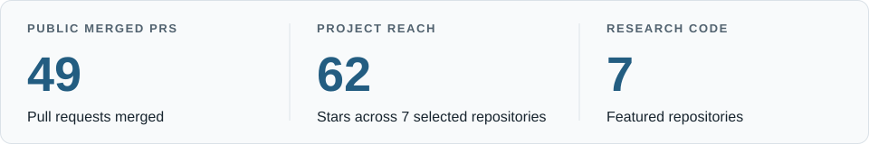

# Haotian Ma

Ph.D. Candidate · **UW–Madison CS** · Founder & Maintainer, **[OpenSAE](https://github.com/OpenSAE)**

[Website](https://atheavenma.github.io/) · [CV](https://atheavenma.github.io/CV.pdf) · [LinkedIn](https://www.linkedin.com/in/Atheaven-Ma) · [Hugging Face](https://huggingface.co/Hunter26666666) · [Email](mailto:hma232@wisc.edu)

I study how learned representations support explanations, interventions, and reliable model behavior. My work combines theoretical analysis, methods, and large-scale evaluations across mechanistic interpretability, language models, and AI for scientific discovery.

## Activity

<picture>
  <source media="(prefers-color-scheme: dark)" srcset="./assets/github-activity-dark.svg" />
  
</picture>

## Achievements

  
  &nbsp;
  
  &nbsp;
  

## Research

<table>
  <tr>
    <td width="50%" valign="top">
      
<strong>🧱 <a href="https://github.com/OpenSAE/SAEBase">SAEBase</a></strong>

      
Research infrastructure for evaluating, understanding, and intervening on sparse autoencoder features in language models.

      
<a href="https://github.com/OpenSAE/SAEBase">Code</a> · <a href="https://huggingface.co/spaces/OpenSAE/SAEBase">Research Lab</a> · <a href="https://huggingface.co/datasets/OpenSAE/SAEBase-Evaluation">Dataset</a>

    </td>
    <td width="50%" valign="top">
      
<strong>🧩 <a href="https://github.com/OpenSAE/SAE-Behavioral-Compositionality">SAR</a></strong>

      
Measures when interventions on SAE features combine additively and when feature interactions change model behavior.

      
<a href="https://github.com/OpenSAE/SAE-Behavioral-Compositionality">Code</a> · <a href="https://arxiv.org/abs/2610.21261">Paper</a> · <a href="https://huggingface.co/spaces/OpenSAE/sar-tutorial">Tutorial</a>

    </td>
  </tr>
  <tr>
    <td width="50%" valign="top">
      
<strong>🔀 <a href="https://github.com/OpenSAE/Redistribution-Sensitivity-Score">RSS</a></strong>

      
Studies systematic redistribution of SAE feature activity under prompt transformations and tests its persistence.

      
<a href="https://github.com/OpenSAE/Redistribution-Sensitivity-Score">Code</a> · <a href="https://huggingface.co/OpenSAE">OpenSAE on Hugging Face</a>

    </td>
    <td width="50%" valign="top">
      
<strong>🔥 <a href="https://github.com/AtheavenMa/Spectral-Spatial-Interpretation">Spectral-Spatial Interpretation</a></strong>

      
Identifies which spectral channels matter at each spatial location for a model's prediction.

      
<a href="https://github.com/AtheavenMa/Spectral-Spatial-Interpretation">Code</a> · <a href="https://arxiv.org/abs/2610.21114">Paper</a> · <a href="https://huggingface.co/spaces/Hunter26666666/SSI_Space">Playground</a>

    </td>
  </tr>
</table>

**Other projects** · 🧭 [SAE Input Localization](https://github.com/OpenSAE/SAE-Input-Localization) · 🎯 [SymSelect](https://github.com/AtheavenMa/SymSelect) · ⏳ [The Limits of Reward Guidance](https://github.com/AtheavenMa/The-Limits-of-Reward-Guidance-under-Finite-Adaptation) · 🧬 [SpatialPheno](https://github.com/AtheavenMa/SpatialPheno) · 🔬 [DeepInfo](https://github.com/AtheavenMa/DeepInfo)

Research directions

- **Faithful representations and mechanistic interpretability.** Understand learned features and test whether they support faithful explanations and interventions.
- **Interpretable AI for scientific discovery.** Connect model predictions to spatial, spectral, and molecular structures.
- **Compositionality and systematic reasoning.** Study how model components and structural transformations combine and generalize.
- **Reliable language models and AI safety.** Examine changing preferences, underspecified user identities, and risks of private-information leakage.

